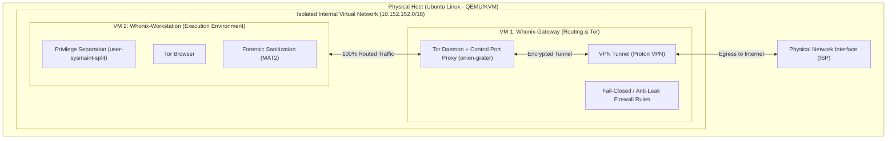

# Beyond VPNs: Full-Spectrum OPSEC Architecture on QEMU/KVM & Whonix


## 1. Executive Summary

This repository documents the design, deployment, and validation of an Operational Security (**OPSEC**) laboratory built to mitigate deanonymization vectors, traffic correlation, and forensic data leaks on Linux workstations.

The environment enforces **compartmentalized isolation** on an Ubuntu host using **QEMU/KVM**, strictly separating network routing (Gateway) from the user execution space (Workstation), and pairing network anonymity with pre-publication file sanitization via **MAT2**.

---

## 2. System Architecture

The network topology ensures that no application running inside the workspace has visibility into the physical host's real IP address or direct access to external network interfaces.



---

## 3. Defense-in-Depth Layers & Risk Mitigation

### A. Hypervisor-Level Isolation (QEMU/KVM)
* **Logical & Network Separation:** The Workstation has no direct external network adapters (neither NAT nor Bridged). Its sole virtual NIC connects exclusively to the isolated internal network managed by `Whonix-Gateway`.
* **Compromise Containment:** In the event of remote code execution (RCE) within the browser or a user-space application on the Workstation, an attacker only gains visibility into the internal virtual subnet (`10.152.152.x`), preventing exposure of the Ubuntu host's MAC address or public IP.

### B. Cascaded Routing (VPN + Tor) & Threat Model Trade-offs
* **Implementation:** The Gateway establishes an encrypted VPN tunnel (Proton VPN) prior to negotiating Tor circuits, verifying channel integrity via `whonixcheck`.
* **Security Trade-off Analysis:** Chaining `User -> VPN -> Tor` conceals Tor usage from the local ISP and prevents the Tor Entry/Guard node from observing the host's real IP address. However, it introduces a trust dependency on the VPN provider and can create a persistent traffic fingerprint if the same VPN exit server is reused across sessions.

### C. OS Hardening & Privilege Separation
* **`user-sysmaint-split` Model:** The Workstation operates under a hardened privilege-separation scheme where the daily workspace account (`user`) lacks privilege escalation capabilities (`sudo` / `su` restricted) and the `root` account remains locked.
* **Security Impact:** Reduces the local attack surface against privilege escalation exploits and malware persistence inside the operational workspace.

### D. Forensic Hygiene & Anti-Fingerprinting (`MAT2`)
* **The Threat:** Network anonymity is rendered ineffective if published files leak identifying metadata (EXIF, XMP, local filesystem paths, or hardware-specific color profiles).
* **The Mitigation:** Prior to transfer or publication, media assets are processed with `mat2` (*Metadata Anonymisation Toolkit 2*), stripping embedded ICC monitor profiles (such as `sRGB` tags or vendor copyright strings) and verifying the absence of residual metadata.

---

## 4. Repository Structure

```text
├── configs/
│   ├── whonix-gateway.xml       # Declarative libvirt VM hardware & network definition
│   └── whonix-workstation.xml   # Declarative libvirt VM hardware & network definition
├── scripts/
│   └── opsec_sanitize.sh        # Automated metadata stripping & SHA-256 audit script
├── screenshots/
│   ├── 01_isolation_routing.jpg # Hypervisor, VPN tunnel, and whonixcheck validation
│   └── 02_mat2_sanitization.png # ICC profile/metadata audit & cleanup with MAT2
└── README.md
```

---

## 5. Sanitization Script Usage

This repository includes a Bash utility (`scripts/opsec_sanitize.sh`) to standardize forensic file cleaning prior to distribution:

```bash
chmod +x scripts/opsec_sanitize.sh
./scripts/opsec_sanitize.sh target_image.jpg
```

The script automates four sequential steps:
1. Inspects and logs all embedded metadata in the source file.
2. Computes the original `SHA-256` cryptographic hash.
3. Generates a sanitized copy (`*.cleaned.*`) via `mat2`.
4. Performs a post-cleaning forensic check and outputs the new `SHA-256` hash.

---

## 6. Validation Evidence

1. **Isolation & Tor/VPN Connectivity Verification:** `screenshots/01_isolation_routing.jpg` validates the concurrent execution of both VMs under QEMU/KVM, the active Proton VPN egress tunnel on the Gateway, and a clean `whonixcheck` diagnostic confirming Tor connectivity and `user-sysmaint-split` enforcement.
2. **Forensic File Audit:** `screenshots/02_mat2_sanitization.png` demonstrates the detection of embedded ICC color profile metadata (`Google Inc. 2016` / `sRGB`) in the raw image and its complete removal following `mat2` sanitization.